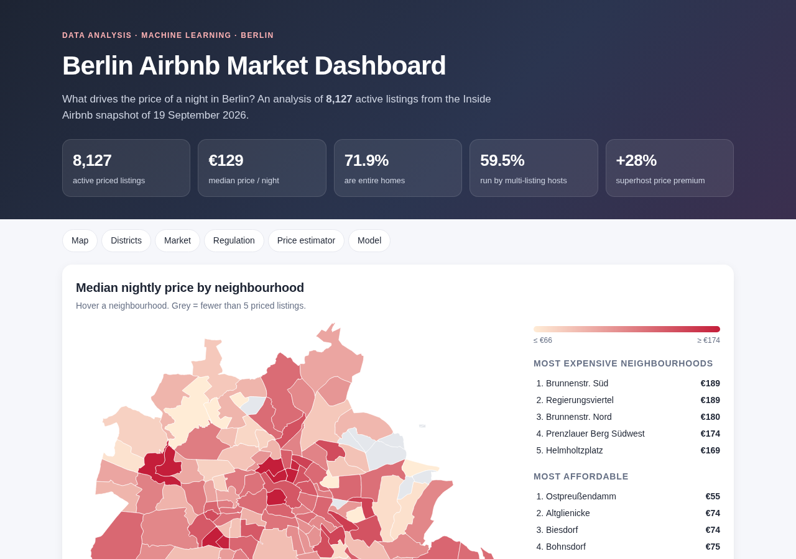
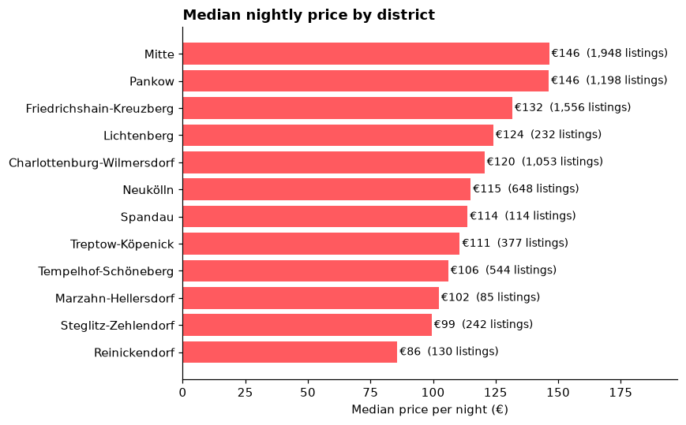
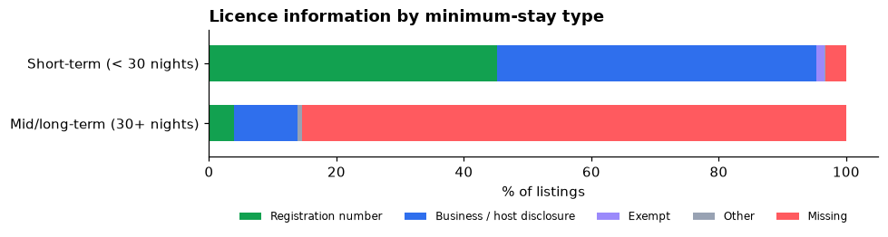
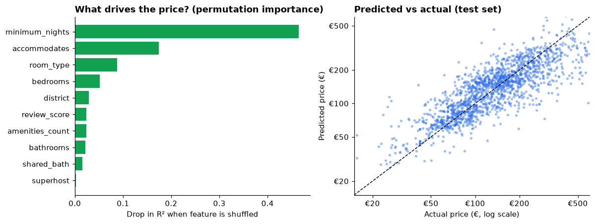

# 🏙️ Berlin Airbnb Market Analysis & Price Prediction

[](https://github.com/sonu2002/berlin-airbnb-analysis/actions/workflows/ci.yml)


An end-to-end data project on **8,127 active Berlin Airbnb listings**: data cleaning, SQL analysis, visual storytelling, a machine-learning price model, and an **interactive dashboard where the model runs live in the browser**.

### 👉 [**Open the live dashboard**](https://sonu2002.github.io/berlin-airbnb-analysis/)

[](https://sonu2002.github.io/berlin-airbnb-analysis/)

---

## 🎯 Business questions
1. Where in Berlin are listings most expensive, and how big is each district's market?
2. How is the market split between room types, and between private and professional hosts?
3. How do short-term listings comply with Berlin's **registration rules** (*Zweckentfremdungsverbot*)?
4. What drives the nightly price, and can it be predicted?

## 💡 Key findings
| # | Finding |
|---|---|
| 1 | **Median price is €129/night.** Mitte and Pankow (median €146) are the most expensive districts; Reinickendorf (€86) is about 40% cheaper. The three central districts hold **58%** of all listings. |
| 2 | **72%** of listings are entire homes, with a median price about €70 above private rooms (€155 vs €86). |
| 3 | **59.5%** of listings belong to multi-listing hosts; the top 1% of hosts control **15.8%** of the market. |
| 4 | Only **3.2%** of short-term listings show no registration number or business disclosure, but **85%** of 30+ night listings show none. Supply has shifted to **furnished mid-term rentals**, which the short-term rules don't cover. |
| 5 | Superhosts charge **28% more** (median) and are booked about **2× as many nights** per year (178 vs 93). |
| 6 | A gradient-boosting model predicts the nightly price with a **median error of €27** (R² 0.66 on log price), cutting the baseline error by 40%. **Minimum stay** is the strongest driver. |




## 🤖 Machine learning
| Model | CV R² (log) | Test R² (log) | MAE | Median error |
|---|---|---|---|---|
| Baseline (median) | -0.001 | 0.000 | €79 | €54 |
| Ridge regression | 0.617 | 0.617 | €51 | €29 |
| Random forest | 0.650 | 0.649 | €48 | €28 |
| **Gradient boosting ✅** | **0.661** | **0.662** | **€47** | **€27** |

- **Target:** `log(price)`, because prices are heavily right-skewed
- **Features:** only things a host can type into a form, so the same model powers the live estimator
- **Validation:** 80/20 split plus 5-fold cross-validation; permutation importance for explanations
- **Deployment without a server:** the 300 fitted trees are exported to JSON and evaluated in JavaScript (`docs/predict.js`). They give the same predictions as scikit-learn (max difference < 0.0001%).



## 🛠️ Tech stack
`Python` · `pandas` · `NumPy` · `scikit-learn` · `Matplotlib` · `SQL (SQLite)` · `Jupyter` · `JavaScript` · `SVG` · `pytest` · `GitHub Actions` · `GitHub Pages`

## 📁 Project structure
```
├── notebooks/berlin_airbnb_analysis.ipynb   ← full analysis story (start here)
├── src/
│   ├── download_data.py        download the Inside Airbnb snapshot
│   ├── clean.py                cleaning + feature engineering (prices, licences, bathrooms)
│   ├── run_sql.py              loads data into SQLite and runs sql/business_questions.sql
│   ├── train_model.py          model comparison, evaluation, export to JSON
│   └── build_dashboard_data.py aggregates + map geometry for the dashboard
├── sql/business_questions.sql  7 business questions in SQL
├── reports/                    figures, SQL results, model metrics
├── docs/                       interactive dashboard (GitHub Pages)
├── tests/                      unit tests for the cleaning logic
└── .github/workflows/ci.yml    runs tests + SQL on every push
```

## 🚀 Run it yourself
```bash
git clone https://github.com/sonu2002/berlin-airbnb-analysis.git
cd berlin-airbnb-analysis
pip install -r requirements.txt
make all          # download → clean → SQL → model → dashboard data → notebook
make serve        # dashboard at http://localhost:8000
```
<sub>Windows without `make`: run the scripts in `src/` in the order shown in the `Makefile`.</sub>

## ⚠️ Limitations
Listing prices are asking prices, not what guests actually paid. Occupancy and revenue are Inside Airbnb estimates. The model has no photos, description text or seasonality, which together probably explain much of the remaining error.

## 📚 Data & licence
Data: [Inside Airbnb](https://insideairbnb.com/get-the-data/), Berlin snapshot of 19 September 2026, licensed CC BY 4.0. Code: MIT.

---
Made by **[Sonu Phogat](https://github.com/sonu2002)** · [LinkedIn](https://www.linkedin.com/in/sonuphogat)
